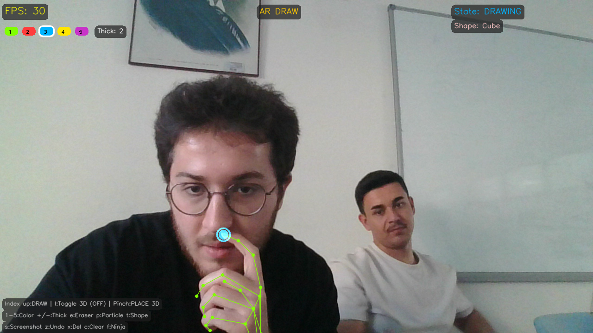

# ⚡ Screen Slicer

<p align="center">
  
  
  
  
  
  
</p>

<p align="center">
  <strong>Webcam Tabanlı, Yeni Nesil Gerçek Zamanlı Artırılmış Gerçeklik (AR) El Hareketi Oyun ve İnteraktif Çizim Paketi</strong>
</p>

<p align="center">
  <a href="#-genel-bakış">Genel Bakış</a> •
  <a href="#-oyun-ve-deneyim-modları">Oyun Modları</a> •
  <a href="#-kontroller-ve-kısayollar">Kontroller</a> •
  <a href="#-el-hareketleri-rehberi">El Hareketleri</a> •
  <a href="#-proje-mimarisi">Mimari</a> •
  <a href="#-kurulum-ve-kullanım">Kurulum</a> •
  <a href="#-sorun-giderme-ve-sss">SSS</a>
</p>

---

<p align="center">
  
</p>

---

## 🌟 Genel Bakış

**Screen Slicer**, sıradan bir web kamerasını yüksek tepki hızına sahip, sıfır gecikmeli bir Artırılmış Gerçeklik (AR) oyun alanına dönüştürür. **Google MediaPipe Tasks Vision (HandLandmarker)**, **OpenCV** ve **NumPy** altyapısıyla çalışan sistem, 21 adet 3 boyutlu el eklemini gerçek zamanlı olarak takip eder; doğal el hareketlerini yüksek hızlı fizik etkileşimlerine, mini oyunlara ve 3B tel kafes uzamsal çizimlere dönüştürür.

Özel bir sensör veya derinlik kamerasına (depth camera) gerek yoktur; yalnızca bilgisayarınız ve standart bir webcam yeterlidir!

### ✨ Öne Çıkan Özellikler

- 🖐️ **21 Eklemli Gerçek Zamanlı Çoklu El Takibi:** Aynı anda 1 veya 2 eli milisaniyenin altında gecikmeyle tespit eder.
- 🎯 **Hareketli Ortalama Filtresi (Moving Average Filter):** Titremesiz imleç ve akıcı kılıç/vuruş hareketleri için koordinat yumuşatma.
- ⚡ **Ultra Modern Glassmorphic Arayüz:** TrueType Segoe UI / Arial pürüzsüz tipografi, yarı saydam cam paneller, neon ışıltılar ve dinamik HUD göstergeleri.
- 🖥️ **Dinamik Tam Ekran & Yüksek DPI Desteği:** Windows ortamında Per-Monitor DPI ölçekleme ile 1080p, 2K ve 4K ekranlarda pikselleşme olmadan kristal netliğinde görüntü.
- 🎮 **7 Entegre Oyun ve AR Deneyimi:** Klavyedeki tek bir tuşa basarak oyunlar ve modlar arasında anında geçiş yapabilme.

---

## 🎮 Oyun ve Deneyim Modları

### 1. 🥊 AR Boks Şampiyonası (`K`)
Sanal ringe adım atın! Ekranda canlandırılan yapay zeka rakip (**TITAN**) ile dövüşün.
- **Yumruk Algılama:** Yumruklarınızı ileri doğru savurarak direkt (jab/cross) ve kroşe vuruşları yapın.
- **Gard Alma ve Kaçış:** İki elinizi yukarı kaldırarak gelen darbeleri bloklayın veya başınızı sağa/sola eğerek gelen yumruklardan kaçın (dodge).
- **Dinamik Geri Bildirim:** İsabet kıvılcımları, havada süzülen hasar sayıları, kombo çarpanı ve kademeli azalan can barları.

### 2. 🍉 Fruit Ninja (`F`)
Klasik meyve kesme heyecanını oturma odanıza taşıyın!
- **Kılıç İzi (Blade Trail):** Hızlı el hareketleriniz ekranda parlayan bir ışık izi oluşturur.
- **Meyve Fiziği:** Karpuz, elma, portakal, limon ve üzümler yerçekimi ivmesiyle havalanır ve kesildiğinde ikiye bölünür.
- **Kombolar ve Bombalar:** Tek bir hamlede birden fazla meyveyi keserek kombo puanı kazanın; araya karışan patlayıcı bombalara dikkat edin!

### 3. 🏒 Neon Hava Hokeyi - Air Hockey (`H`)
Kamera görüntünüzün üzerinde iki kişilik neon masa hokeyi keyfi.
- **Çift Tokmak (Mallet):** 1. Oyuncu üst tokmakla, 2. Oyuncu alt tokmakla oynar (veya tek başınıza iki elinizle oynayabilirsiniz).
- **Gerçekçi 2B Elastik Fizik:** Duvarlardan sekme, hıza duyarlı çarpışmalar, sürtünme ve kale çizgisi tespiti.
- **Efektler:** Gol kutlamaları, hızlanan diskin arkasında bıraktığı parçacık izleri ve sert vuruşlarda ekran sarsıntısı.

### 4. 🏀 Fizik Tabanlı Basketbol (`B`)
Şut yeteneğinizi ve el çabukluğunuzu test edin.
- **Top Etkileşimi:** Basketbol topunu parmak uçlarınızla hafifçe veya sertçe iterek potaya doğru fırlatın.
- **Hareketli Pota Modu:** `1` tuşu ile sabit pota, `2` tuşu ile sağa sola salınan hareketli pota moduna geçiş yapın.
- **Fizik Motoru:** Yerçekimi, panya çarpışmaları ve file geçişleri.

### 5. 🏹 Hassas Okçuluk (`A`)
Sanal bir okçu gibi yayı gerin ve hedefi vurun.
- **Yay Mekaniği:** Elinizle kirişi geriye doğru çekin; ekranda dinamik atış rotası (trajektori) çizilir.
- **Balistik Fizik:** Yerçekimi ve mesafe hesabı ile gerçekçi ok uçuşu, hedef tahtasında tam on ikiden vurma (Bullseye) puanlaması.
- **Hareketli Hedef Modu:** `1` tuşu ile sabit hedef, `2` tuşu ile yukarı-aşağı hareket eden hedef.

### 6. ☀️ Avuçta Güneş & Kara Delik (`G`)
Kozmik enerjiyi avucunuzun içinde hissedin!
- **Dinamik Enerji Küresi:** Açık avucunuzun üzerinde dönen, kıvılcımlar ve parçacıklar saçan canlı bir yıldız simülasyonu.
- **Çift El Desteği:** Bir elinizde parlak bir yıldız taşırken, diğer elinizle uzayı büken bir Kara Delik (Black Hole) oluşturabilirsiniz.
- **Renk Döngüsü (`Boşluk`):** Ateş (Fire), Plazma (Plasma), Standart Sarı Yıldız, Beyaz Cüce ve Kara Delik arasında geçiş yapın.

### 7. 🎨 AR 3B Çizim & Geometrik Modeller (`D`)
Havada parmaklarınızla 3 boyutlu çizim yapın ve modeller yerleştirin.
- **Kıstırma ile Çizim:** İşaret ve orta parmağınızı birleştirerek uzayda neon fırça darbeleri bırakın.
- **3B Tel Kafes Katılar (`T`):** Küp (**Cube**), Piramit (**Pyramid**) ve Elmas (**Diamond**) modellerini havaya yerleştirin ve döndürün.
- **Çizim Araçları:**
  - `1-5`: Renk paleti seçimi
  - `+/-`: Fırça çizgi kalınlığını artırma/azaltma
  - `E`: Silgi modu
  - `P`: Parçacık fırçası (Particle spray)
  - `Z` / `X`: Son çizgiyi veya son nesneyi geri alma (Undo)

---

## ⌨️ Kontroller ve Kısayollar

| Tuş | Kapsam | Açıklama |
|:---:|:---:|---|
| <kbd>M</kbd> | Genel | **Ana Menü / Kontrol Paneli**'ne döner |
| <kbd>U</kbd> | Genel | **Tam Ekran (Fullscreen)** modunu açar / kapatır |
| <kbd>S</kbd> | Genel | Yüksek çözünürlüklü **Ekran Görüntüsü (Screenshot)** kaydeder |
| <kbd>Q</kbd> / <kbd>ESC</kbd> | Genel | Uygulamadan çıkar |
| <kbd>K</kbd> | Mod Geçişi | **AR Boks Modu**'nu başlatır |
| <kbd>F</kbd> | Mod Geçişi | **Fruit Ninja Modu**'nu başlatır |
| <kbd>H</kbd> | Mod Geçişi | **Air Hockey Modu**'nu başlatır |
| <kbd>B</kbd> | Mod Geçişi | **Basketbol Modu**'nu başlatır |
| <kbd>A</kbd> | Mod Geçişi | **Okçuluk Modu**'nu başlatır |
| <kbd>G</kbd> | Mod Geçişi | **Avuçta Güneş Modu**'nu başlatır |
| <kbd>D</kbd> | Mod Geçişi | **AR Çizim ve 3B Şekiller Modu**'nu başlatır |
| <kbd>R</kbd> | Oyun İçi | Aktif oyunu **yeniden başlatır** (Fruit Ninja / Air Hockey / Boks) |
| <kbd>Boşluk</kbd> | Güneş Modu | Güneş / Kara Delik renklerini değiştirir |
| <kbd>1</kbd> / <kbd>2</kbd> | Mini Oyunlar | Sabit / Hareketli hedef modları (Basketbol ve Okçuluk) |
| <kbd>1</kbd> - <kbd>5</kbd> | AR Çizim | Çizim rengini değiştirir |
| <kbd>+</kbd> / <kbd>-</kbd> | AR Çizim | Çizgi kalınlığını artırır / azaltır |
| <kbd>E</kbd> | AR Çizim | **Silgi (Eraser)** modunu açar / kapatır |
| <kbd>P</kbd> | AR Çizim | **Parçacık Fırçası** modunu açar / kapatır |
| <kbd>T</kbd> | AR Çizim | 3B şekli değiştirir (**Küp** / **Piramit** / **Elmas**) |
| <kbd>Z</kbd> | AR Çizim | Son çizilen çizgiyi **geri alır** |
| <kbd>X</kbd> | AR Çizim | Son yerleştirilen 3B nesneyi **siler** |
| <kbd>C</kbd> | AR Çizim | Tuvali **tamamen temizler** |

---

## 🖐️ El Hareketleri Rehberi

```
      PARMAK KISTIRMA                 AÇIK AVUÇ                     SIKILI YUMRUK
     (Çizim / Dilimleme)           (Kozmik Enerji)                  (Boks Vuruşu)
            /\                         \  |  /                         ____
           /  \                         \ | /                         |####|
          /    \                         \|/                          |####|
     [İşaret + Orta]                 [Açık Avuç]                   [Sıkılı Yumruk]
```

- **İşaret Parmağı (İmleç):** Menüleri gezmek ve öğeleri konumlandırmak için sadece işaret parmağınızı uzatın.
- **Çizim / Kesme / Fırlatma:** İşaret ve orta parmağınızı yan yana getirip birleştirerek havada çizim yapın veya meyveleri dilimleyin.
- **3B Şekil Etkileşimi:** Başparmak ile işaret parmağını kıstırarak 3B nesneleri ölçeklendirin veya döndürün.
- **Enerji Küresi Tutma:** Kameraya doğru avuç içinizi tamamen açın; enerji küresi elinizin merkezine yerleşecektir.
- **Yumruk & Gard:** Elinizi yumruk yaparak öne doğru itin; iki elinizi yüz hizasına kaldırarak gard alın.

---

## 📁 Proje Mimarisi

```
Screen Slicer/
├── main.py                 # Ana uygulama döngüsü, yüksek DPI kontrolü, mod yöneticisi
├── hand_tracker.py         # MediaPipe Tasks Vision çoklu el takip motoru (21 eklem)
├── hand_landmarker.task    # Google MediaPipe HandLandmarker yapay zeka modeli
├── gesture_engine.py       # El hareketi tespiti, parmak durumları ve çizim motoru
├── geometry_engine.py      # 3B perspektif izdüşüm, dönme matrisleri ve tel kafes şekiller
├── ui_engine.py            # Glassmorphism UI motoru, TrueType pürüzsüz yazı, neon parıltılar
├── boxing_engine.py        # AR Boks motoru: Yapay zeka rakip, yumruk/kaçış algılama, can HUD
├── fruit_ninja.py          # Fruit Ninja motoru: Balistik meyve fiziği, kılıç izi, kombo sistemi
├── air_hockey.py           # 2 Kişilik Air Hockey: 2B çarpışma fiziği, tokmaklar, gol animasyonları
├── basketball_engine.py    # Basketbol fiziği, hareketli pota ve şut algılama
├── archery_engine.py       # Okçuluk mekaniği, atış trajektorisi ve hedef puanlama
├── sun_engine.py           # Avuç içine kilitlenen güneş ve kara delik parçacık simülasyonu
├── requirements.txt        # Gerekli Python paketleri
├── Oyunu_Baslat.bat        # Windows için tek tıkla başlatma betiği
├── LICENSE                 # MIT Açık Kaynak Lisansı
└── README.md               # Detaylı dokümantasyon ve kullanım kılavuzu
```

---

## 🚀 Kurulum ve Kullanım

### 1. Gereksinimler
- **Python 3.9** veya üzeri ([Python İndir](https://www.python.org/downloads/))
- Çalışır durumda bir **Webcam** (Dahili veya Harici USB Kamera)

### 2. Projeyi Klonlayın
```bash
git clone https://github.com/FireNemesisx/Screen-Slicer.git
cd Screen-Slicer
```

### 3. Sanal Ortam Oluşturun (Önerilir)
```bash
# Windows
python -m venv venv
.\venv\Scripts\activate

# Linux / macOS
python3 -m venv venv
source venv/bin/activate
```

### 4. Gerekli Paketleri Yükleyin
```bash
pip install -r requirements.txt
```

### 5. Uygulamayı Başlatın
```bash
python main.py
```

> 💡 **Windows Kolay Başlatma:** Proje klasöründeki **`Oyunu_Baslat.bat`** dosyasına çift tıklayarak uygulamayı komut satırına gerek kalmadan doğrudan başlatabilirsiniz.

---

## 🛠️ Sorun Giderme ve SSS

<details>
<summary><strong>1. "Model not found: hand_landmarker.task" Hatası</strong></summary>

`hand_landmarker.task` dosyasının `main.py` ile aynı dizinde bulunduğundan emin olun. Dosya eksikse doğrudan Google MediaPipe deposundan indirebilirsiniz:
```bash
# Doğrudan model indirme bağlantısı:
# https://storage.googleapis.com/mediapipe-models/hand_landmarker/hand_landmarker/float16/1/hand_landmarker.task
```
</details>

<details>
<summary><strong>2. Kamera açılmıyor veya siyah ekran görünüyor</strong></summary>

- Kameranızın başka bir uygulama (Zoom, Teams, Discord, vb.) tarafından kullanılmadığından emin olun.
- Birden fazla kameranız varsa, `main.py` içindeki `cv2.VideoCapture(0)` indeksini `cv2.VideoCapture(1)` olarak değiştirmeyi deneyin.
- Windows Ayarları > Gizlilik > Kamera menüsünden masaüstü uygulamaları için kamera erişim izninin açık olduğunu doğrulayın.
</details>

<details>
<summary><strong>3. Düşük FPS veya Gecikme Hissiyatı</strong></summary>

- El eklemlerinin doğru ve hızlı tespit edilmesi için odanın iyi aydınlatılmış olduğundan emin olun.
- Eski donanımlarda performansı artırmak için `main.py` dosyasındaki kamera çözünürlüğünü optimize edebilirsiniz.
</details>

---

## 📄 Lisans

Bu proje **[MIT Lisansı](LICENSE)** ile lisanslanmıştır. Dilediğiniz gibi kullanabilir, geliştirebilir ve paylaşabilirsiniz.

## 👤 Geliştirici

**[Etka Kudret Çeliköz](https://github.com/FireNemesisx)** tarafından geliştirilmiştir.  
Katkıda bulunmak için issue açabilir veya pull request gönderebilirsiniz!
